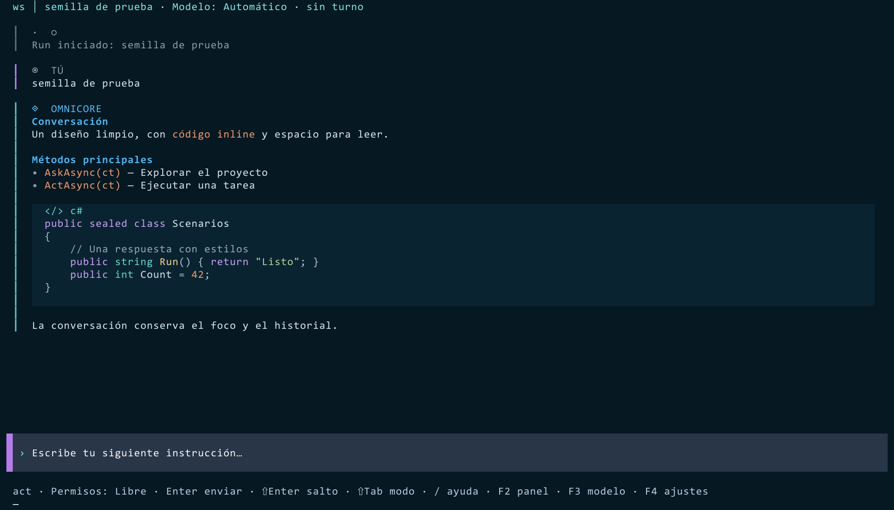
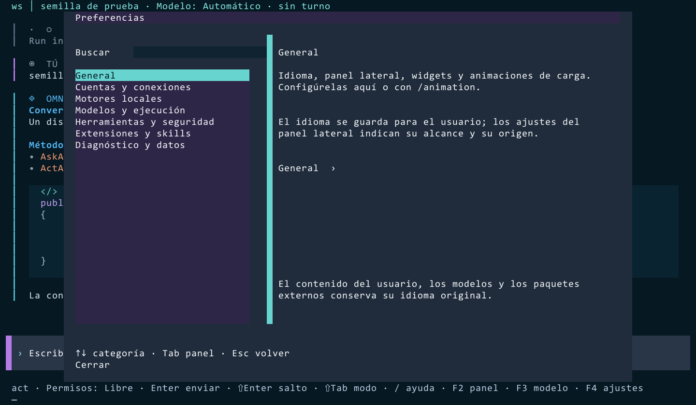
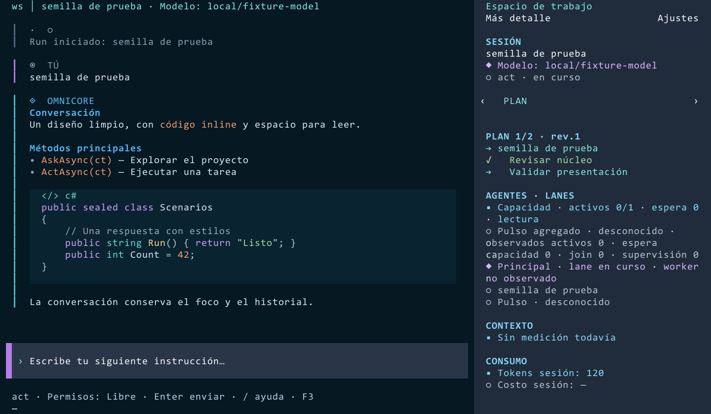
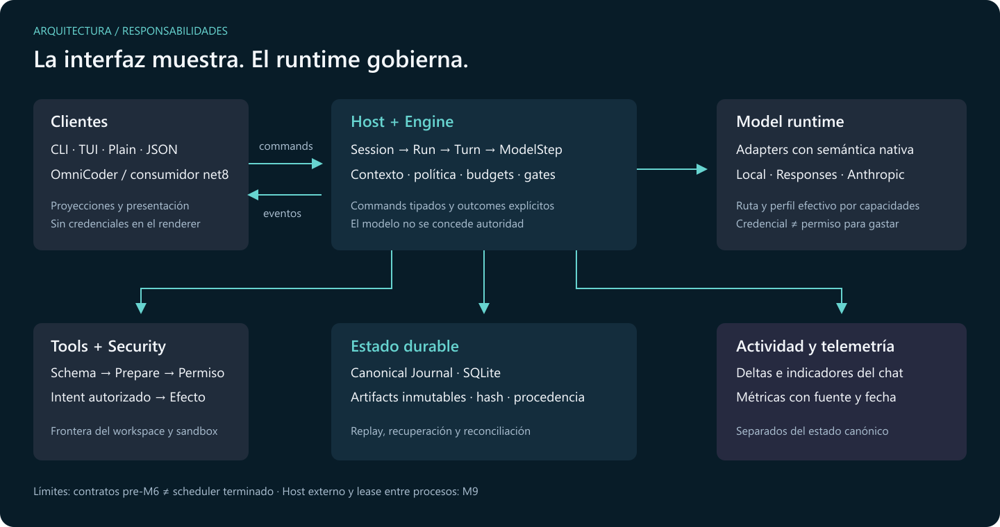
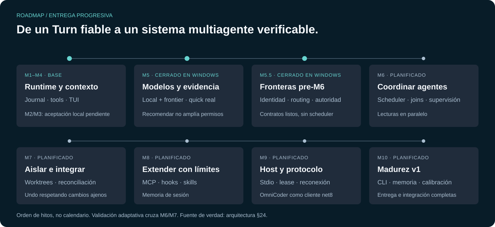

# OmniCore

### Runtime local-first para agentes de IA, modelos y repositorios bajo control explícito.

OmniCore es un runtime **local-first en C#/.NET 10** para trabajar sobre repositorios con modelos locales o de frontera. Su primer cliente es el CLI `omni`; Protocol y Client también están preparados para consumidores como OmniCoder.

La meta es una conversación que conserva contexto, puede inspeccionar y modificar código dentro de permisos explícitos y entrega resultados respaldados por evidencia. Cambiar el modelo no debería exigir cambiar la tarea ni el motor.

[Primeros pasos](#primeros-pasos) · [Experiencia objetivo](#experiencia-objetivo) · [Panel lateral](#panel-lateral-de-sesión) · [Simplicidad y contexto](#simplicidad-y-contexto) · [Estado actual](#estado-actual) · [Roadmap](#roadmap-hacia-v1) · [Documentación](#documentación)



*Captura exportada del driver real de Terminal.Gui (140 × 40 celdas). El contenido procede de un fixture determinista; no es una conversación con un modelo.*



*Captura exportada del driver real de Terminal.Gui (120 × 35 celdas), también con datos de prueba y sin conexión a proveedores.*

## Experiencia objetivo

Una interfaz para consultar, planificar, implementar y verificar sin perder el contexto de la conversación ni delegar autoridad al modelo.

| Objetivo | Garantía del producto |
|---|---|
| **Conversación útil** | Respuestas en el chat, código legible, tablas Markdown, referencias y resultados de herramientas. Las consultas explicativas no requieren crear archivos ni agentes hijos. |
| **Edición eficiente** | Campo multilínea adaptable, cursor visible, ayuda de comandos y navegación al último mensaje sin forzar el desplazamiento mientras se consulta el historial. |
| **Elección de modelos** | Selector de modelo y administración separada del catálogo, la visibilidad, los perfiles y las políticas. No se sustituyen modelos de forma que amplíe silenciosamente el gasto o los permisos. |
| **Actividad comprensible** | Estados distintos para espera, razonamiento, respuesta, herramientas y aprobación; los indicadores se retiran al completar, cancelar, fallar o cambiar de sesión. |
| **Contexto y consumo claros** | Contexto actual separado del consumo acumulado; fuente y fecha; valores reportados, estimados o no disponibles identificados. |
| **Trabajo comprobable** | Plan y evidencias inspeccionables: una afirmación del modelo no equivale a un test ejecutado ni a una integración verificada. |
| **Continuidad** | Sesiones persistidas, recuperación tras interrupciones y artifacts verificables, sin duplicar efectos al reanudar. |

El lenguaje visual previsto combina superficies oscuras, acentos cian y violeta, selección clara y paneles sin marcos pesados. La conversación ocupa el área principal; los detalles aparecen cuando son necesarios.

### Un mismo núcleo, distintos clientes

- **TUI:** conversación interactiva en terminal, panel lateral, selección de modelos, comandos y aprobaciones.
- **Plain:** salida legible para terminales sencillos y flujos no interactivos.
- **JSON/NDJSON:** eventos y outcomes estructurados para automatización.
- **OmniCoder:** consumidor de Protocol y Client. Host separado, transporte y reconexión completos pertenecen al roadmap; no se presentan como producto final ya entregado.

Los clientes dibujan la experiencia. El Core decide estado, permisos, budgets y evidencia. Credenciales y consultas autenticadas no pertenecen al renderer.

## Panel lateral de sesión

El panel reúne el estado del trabajo junto a la conversación. Su propósito es permitir
entender qué está ejecutándose, qué contexto recibió el modelo y qué resultados están
respaldados por evidencia, sin tener que reconstruirlo leyendo todo el chat.



*Frame exportado del driver de Terminal.Gui a 120 × 35 celdas. Modelo, plan y consumo
son datos deterministas de prueba; los estados sin medición se muestran explícitamente.*

| Área | Información y acciones disponibles |
|---|---|
| **Sesión** | Título, modelo, modo y estado del Run activo. |
| **Plan** | Jerarquía de tareas, revisión, estado y progreso; navegar entre elementos no ejecuta una tarea. |
| **Contexto** | Snapshot de la última solicitud, categorías, conteo y procedencia. Se distingue de los tokens acumulados de la sesión. |
| **Consumo** | Tokens y costo registrados, con valores medidos, estimados o desconocidos identificados. Las cuotas aparecen cuando el proveedor las informa. |
| **Agentes y caminos de ejecución** | Tareas, delegaciones, capacidad, espera, supervisión y resultados. El inspector permite consultar detalle e historial; un resultado devuelto conserva su estado de revisión. |
| **Archivos y efectos** | Cambios registrados por la sesión y su atribución. El diff usa preimagen/postimagen conservadas, para no mezclar cambios posteriores de otra persona o proceso. |
| **Diagnóstico** | Información disponible para detectar errores, recuperación y datos incompletos. |

`F2` muestra u oculta el panel. Cada categoría presenta un resumen con **Más…**
para desplegar sus detalles y **Menos** para contraerlos de forma independiente.
Los enlaces funcionan con clic y con Enter al enfocarlos. Las categorías se
recorren en el mismo panel desplazable, también en ventanas estrechas.
En **General → Panel lateral y widgets** se configuran visibilidad, tamaño y
prioridad; las preferencias indican su alcance y origen. El foco y la selección
se conservan durante cambios de tamaño.

El panel se amplía conforme se conectan funciones del núcleo: los futuros controles de
memoria entre sesiones, búsqueda e integraciones tendrán acciones sobre los mismos
servicios del Host. Se documentarán como disponibles cuando sus recorridos estén
implementados y verificados.

## Cómo funciona



*Mapa de responsabilidades, no declaración de que scheduler, joins o transporte externo estén terminados.*

Una solicitud se convierte en un **Turn** dentro de una Session y un **Run**. El modelo recibe una proyección acotada del contexto y puede responder o solicitar herramientas. Cada herramienta pasa por validación, preparación y autorización antes de producir efectos. El estado relevante se registra para inspeccionarlo y reconstruirlo.

| Concepto | Qué significa |
|---|---|
| **Session / Run** | La sesión identifica la conversación; el Run conserva el trabajo activo hasta superar sus gates. |
| **Turn / ModelStep** | Una intención lógica puede necesitar varias llamadas al modelo. Suspender por una aprobación no debe perder pasos, contexto ni consumo. |
| **Task / Lane / AgentExecution** | Trabajo, camino de ejecución e instancia concreta. Scheduler M6 con lectores paralelos y escritoras serializadas en un Host compartido. |
| **ModelRoute / AgentProfile** | Cómo acceder al modelo y qué capacidades/política efectiva aplicar, sin permisos inventados por el modelo. |
| **Journal / Artifacts** | Eventos canónicos append-only para el estado; contenido inmutable identificado por hash para respuestas, contexto y evidencias. |
| **Completion Gates** | Condiciones verificables: «el modelo terminó» y «el trabajo está validado» son cosas diferentes. |

### Modos y autoridad

**PLAN, ACT y ORQ los elige el usuario.** El esfuerzo de razonamiento no cambia el modo, no habilita herramientas y no autoriza gasto por sí solo.

UltraCode es un preset de esfuerzo del producto, no un cuarto modo ni un modelo. Sólo una autorización explícita y durable permite transiciones de política acotadas. Consulte [las decisiones de modos y UltraCode](docs/adr/README.md) y [su contrato efectivo](docs/architecture/mode-proposals.md).

### Local-first no implica que todo sea gratuito

Se distinguen rutas locales, cuota incluida, facturación monetaria y condiciones desconocidas. Una credencial no equivale a autorización para gastar. Cuotas y créditos sólo se muestran cuando la fuente los informa: desconocido no es cero y saldo de cuenta no equivale al límite de una clave.

Las cuotas propias de tokens y costo son opcionales. Se aplican cuando el usuario
las declara; la sesión no recibe un presupuesto monetario arbitrario al abrirse.
El catálogo admite una **salida máxima opcional**: dejar el campo vacío elimina el
límite solicitado, y cada ruta informa qué controles de generación soporta.

### Controles del harness por modelo

Cada modelo tiene una política operativa que limita sus capacidades. Las categorías
de lectura, parches, edición acotada y agente completo sirven como punto de partida;
la elección se guarda por identidad configurada de proveedor/modelo, sin deducir
autoridad del nombre comercial o del tamaño del modelo.

Desde **Modelos y ejecución → Modelos y políticas**, los controles del perfil permiten
restringir herramientas básicas y avanzadas, coordinación, archivos y líneas por
turno, proporción de reescritura, lectura previa, versión y validación posterior.
Así, un modelo destinado a parches puede mantener acceso a lectura y búsqueda mientras
se rechazan reemplazos completos o mutaciones que superen su alcance.

Los límites de pasos, llamadas a herramientas y tiempo por generación permiten cortar
ciclos sin progreso. La cancelación por tiempo se muestra como una interrupción;
la configuración de razonamiento usa las capacidades que ofrece el proveedor.
Estos controles se aplican tanto al catálogo visible como a la ejecución de una llamada.

## Simplicidad y contexto

Un harness no necesita ocupar gran parte de la ventana antes de empezar a trabajar.
Mantener las instrucciones y el catálogo de herramientas acotados deja más espacio
para el código, las evidencias y la conversación. La simplicidad reduce ese costo
fijo; no implica quitar controles de seguridad ni ofrecer menos autoridad de forma
oculta. Los perfiles de OmniCore hacen explícito qué herramientas se ofrecen.

Capturamos la primera solicitud de los cinco harnesses instalados contra un servidor
HTTP de prueba local, con el mismo proyecto nuevo y la misma pregunta. El conteo
usa `o200k_base`, excluye la pregunta original y normaliza los bloques de texto:
es contexto de referencia, **no consumo facturado ni una prueba de calidad**.

| Harness / perfil | Herramientas ofrecidas | Contexto inicial inyectado, tokens de referencia |
|---|---:|---:|
| OmniCore · Observación | 6 | 1.161 |
| OmniCore · Parches | 7 | 1.215 |
| OmniCore · Programación acotada | 10 | 1.455 |
| OmniCore · Agente completo | 12 | 1.641 |
| Pi 1.1.0 · Base | 4 | 1.385 |
| OpenCode 1.18.35 · Build | 10 | 6.916 |
| OpenCode 1.18.35 · Plan | 10 | 7.213 |
| Codex CLI 0.153.4 · Base, read-only | 11 | 10.245 |
| Claude Code 2.1.296 · Base, manual | 22 | 14.805 |

En esta captura, los perfiles de OmniCore inyectan **entre un 76,3 % y un 83,2 %
menos contexto fijo que OpenCode Build**. Pi también ilustra la ganancia de un
catálogo pequeño: su configuración base usa aproximadamente un **80,0 % menos**
que OpenCode Build. OmniCore no es el menor en todos los casos: Pi usa menos que
sus perfiles de programación acotada y agente completo. Frente a las solicitudes
capturadas de Codex CLI y Claude Code, la reducción de OmniCore es de **84,0–88,7 %**
y **88,9–92,2 %**, respectivamente.

Los conjuntos de herramientas y sus contratos no son equivalentes. Estas cifras
no prueban mayor capacidad, mejor respuesta, más velocidad ni el mismo ahorro
en factura. Historial, skills, instrucciones propias, rutas y versiones cambian
el resultado; la captura no utiliza cuentas ni inferencia real. La fila de Codex
mide el CLI aislado, **no ChatGPT web ni esta conversación en la app de Codex**.
Los catálogos namespace dentro de `input.additional_tools` se incluyen: las 11
funciones declaradas no significan que haya sólo 11 operaciones accesibles por `exec`.

[Tabla HTML completa de herramientas y contexto](docs/reports/harness-tools-20261011.html#contexto-inicial)
· [Método, versiones, hashes y reproducción](docs/validation/initial-context-20261013.md)
· [Datos de las nueve capturas](docs/validation/assets/initial-context-20261013.json).

## Estado actual

Resumen documental al **12 de octubre de 2026**. La [arquitectura §24](docs/architecture/arquitectura.md) y las evidencias enlazadas son la fuente de verdad; este README no sustituye la aceptación de cada hito.

| Hito | Estado | Evidencia y alcance |
|---|---|---|
| **M1 · Runtime y planning** | Cerrado en Windows | Dominio, journal, permisos, simulación y reconciliación determinista. |
| **M2 · Explorer** | Código completo | Contexto y turnos persistidos; aceptación del usuario con su modelo local pendiente según [validación M1–M4](docs/validation/m1-m4.md). |
| **M3 · Mutaciones y procesos** | Código completo | Herramientas, fronteras y errores tipados; aceptación real local pendiente. Sandbox Strong en Linux diferido. |
| **M4 · Contexto y TUI v0** | Cerrado en Windows | [200 turnos, recuperación en otro proceso y TUI en PTY](docs/validation/m4-closure-20261005.md). No acredita reinicio de Windows ni validación Linux. |
| **M5 · Modelos y cualificación** | Cerrado en Windows | [Quick real de ChatGPT por suscripción y Qwen local](docs/validation/m5-closure-20261007.md). Una recomendación no modifica automáticamente la política. |
| **M5.5 · Fronteras pre-M6** | Cerrado en Windows | [Acta integral](docs/validation/m55-closure-20261007.md): continuidad protegida, cotas y autoridad, atribución, fingerprint, preimágenes y contratos. 2.958 PASS, 0 FAIL, 4 SKIP; arquitectura 56 PASS. |
| **M6 · Multiagente** | Cerrado en Windows | [Acta integral](docs/validation/m6-integration-20261008.md): Explore/Implement/Verify con Plan reconciliado, scheduler, budgets, joins/FanOut, supervisión/mailbox, background e inspector. [Revisión de cableado del 09-10](docs/validation/m6-wiring-audit-20261009.md): 3.292 PASS, 0 FAIL, 4 SKIP; arquitectura 56 PASS y recuperación M4 serial verde. Un Host compartido. |
| **M7 · Aislamiento** | Cerrado en Windows | [Acta y alcance](docs/validation/m7-isolation-20261010.md): integración autorizada y recuperación, lanes aisladas, continuidad Implement→Verify, undo compensatorio y retención. |
| **M8 · Extensibilidad** | En construcción | Extensiones/comandos/skills Project y Session Memory integrados, incluida memoria efectiva en el modelo. Faltan scopes/aportes, hooks, MCP, preferencias de herramientas y candidatos/promoción. [Matriz de entregas](docs/validation/m8-extensibility-20261011.md). |
| **M9–M10** | Avance parcial | Bases Protocol/Client, inspección y undo disponibles; transporte/Host separado, memoria multiscoped y cierre v1 pendientes. [Plan restante, idiomas y herramientas](docs/plans/m8-m10-user-localization.md). |

La evidencia de cierre M5 documenta **2995 casos: 2991 correctos, 0 fallos y 4 omitidos por permisos de symlink**. Es un resultado fechado, no un contador actualizado automáticamente aquí. Las pruebas con fixtures se distinguen de llamadas autenticadas reales.

### Modelos y proveedores

| Conexión | Implementación | Validación documentada |
|---|---|---|
| **ChatGPT por suscripción** | Login y Responses con perfil Codex | Quick autenticada real de la ruta documentada en M5. |
| **Local / llama.cpp** | Chat compatible, configuración y supervisión de host local | Quick real de Qwen en la configuración documentada; no cualifica automáticamente cualquier modelo local. |
| **OpenAI Responses API** | Adapter nativo | Fixtures; aceptación con API de pago no acreditada en el cierre M5. |
| **Anthropic Messages** | Adapter nativo y semántica del proveedor | Fixtures; aceptación autenticada de API pendiente. |
| **OpenRouter** | Conexiones User, catálogo/registro de modelos, adapter compatible y créditos en CLI/TUI | Base integrada en `3273026`; OR4 reabierto por aceptación de interfaz y OR5 autenticado pendiente. [Plan](docs/plans/openrouter-closure.md) y [auditoría del menú](docs/validation/tui-menu-audit-20261016.md); M8 sigue abierto. |

Disponibilidad y cuotas dependen de la cuenta y del proveedor en el momento de la consulta. No hay una lista universal de modelos garantizados para todos los usuarios.

## Primeros pasos

### Requisitos

Se requiere el **SDK de .NET 10** y Git. Protocol, Client y Sandbox también tienen como destino .NET 8 para OmniCoder. La TUI utiliza Terminal.Gui sobre el SDK oficial de .NET.

### Compilación y pruebas

```powershell
git clone https://github.com/juancgomezm-s/OmniCore.git
cd OmniCore
dotnet build OmniCore.slnx
dotnet test --solution OmniCore.slnx
```

### Instalar `omni` en Windows

Esta instalación de desarrollo compila el checkout elegido y registra `omni`
con npm. Requiere Git, **Node.js 20 o posterior con npm** y el **SDK de .NET
10.0.401**, o una banda posterior de .NET 10 admitida por `global.json`.
El SDK incluye el runtime necesario para ejecutar la aplicación.

Desde el repositorio clonado en el paso anterior, en PowerShell:

```powershell
.\scripts\install.ps1
omni.cmd --help
omni
```

Utiliza el prefijo global de npm ya configurado. Para elegir otra carpeta:
`.\scripts\install.ps1 -Prefix "$env:LOCALAPPDATA\OmniCore-cli"`; agrega esa
carpeta al `PATH` del usuario. No es necesario cambiar la política de scripts
de npm ni publicar el paquete en el registro.

### Instalar en Linux / Debian / WSL

Dentro de Linux deben estar disponibles **Git, Bash, Node.js 20+ con npm y
el SDK de .NET 10** indicado arriba. Son instalaciones de Linux; tener las
herramientas solamente en Windows no basta. Comprueba `node --version`,
`npm --version` y `dotnet --info` en esa terminal. Instrucciones oficiales:
[Node.js](https://nodejs.org/en/download) y
[.NET para Debian](https://learn.microsoft.com/dotnet/core/install/linux-debian).
En WSL, utiliza una terminal interactiva como Windows Terminal.
Si instalaste el SDK manualmente en `~/.dotnet`, agrega antes
`export DOTNET_ROOT="$HOME/.dotnet"` y
`export PATH="$DOTNET_ROOT:$PATH"` a la sesión y a `~/.profile`.

```bash
git clone https://github.com/juancgomezm-s/OmniCore.git
cd OmniCore
bash scripts/install.sh
export PATH="$HOME/.local/bin:$PATH"
omni --help
omni
```

Instala en `~/.local`, sin `sudo`; conserva la línea de `PATH` en `~/.profile`
si todavía no la tienes. Puedes elegir otro destino con
`bash scripts/install.sh --prefix "$HOME/aplicaciones/omnicore"` y agregar
su subcarpeta `bin` al `PATH`. Conserva también `dotnet` en el `PATH`:
esta distribución npm necesita el **runtime .NET 10** al ejecutarse.

### Actualizar la aplicación instalada

Cierra las instancias de OmniCore que usan la instalación que vas a actualizar.
En un clon limpio de la rama `main`, descarga los cambios y repite el instalador:

```powershell
git pull --ff-only
.\scripts\install.ps1
omni.cmd --help
```

En Linux, los dos primeros pasos son `git pull --ff-only` y
`bash scripts/install.sh`; comprueba con `omni --help`. Si elegiste un prefijo,
reutiliza el mismo al actualizar. El instalador compila y verifica el arranque
antes de pedir a npm que reemplace el paquete. Si la compilación, comprobación
o creación del paquete falla, no inicia la sustitución. Propaga cualquier error
de npm; una instalación fallida no se acredita como actualización correcta.
Muestra la ruta del `.tgz` preparado, que se conserva para reinstalarlo con
`npm install --global --ignore-scripts <ruta-al-tgz>` (y el mismo `--prefix`,
si corresponde). Este archivo ya contiene la CLI compilada.

Los scripts instalan el contenido del checkout actual; no descargan cambios ni
modifican cuentas, preferencias, sesiones o workspaces. `main` es el canal de
desarrollo. Para fijar una revisión, usa `git checkout <SHA>` antes de instalar;
no se presenta como una release estable. El servicio de actualización desde
GitHub Releases y los comandos `omni update ...` siguen previstos en
[M10](docs/plans/github-updates.md).

Ejecuta `omni` desde la carpeta del proyecto para abrir la interfaz integrada
con categorías laterales de preferencias. También está disponible `omni tui`.
Sin argumentos necesita una terminal interactiva; para scripts, utiliza un
subcomando explícito, como `omni sim --json`.

### Configurar OpenRouter

En la TUI abre **F4 → Cuentas y conexiones → OpenRouter…**. El formulario
muestra directamente el campo de clave; **Guardar** la almacena en las credenciales
protegidas del usuario. **Probar** consulta su validez;
**Descubrir modelos** abre el catálogo, cuyo refresh se solicita explícitamente.
Registra sólo los modelos elegidos y luego selecciónalos mediante el selector
de modelos habitual. **Consultar créditos…** muestra los límites de clave y el saldo
disponible, con actualización explícita. Cada proveedor API abre su formulario dentro
de Preferencias, sin volver a seleccionarlo. `/openrouter`, `/login` y sus variantes
no se ofrecen en los comandos de la TUI. La lista muestra una sola grafía en el idioma de la interfaz;
Los identificadores canónicos se conservan para la CLI de automatización.

También puedes configurar la conexión por CLI:

```powershell
omni /openrouter connect
omni /openrouter status
```

La primera orden solicita la clave con entrada oculta; no la agregues a los
argumentos. Usa el ID mostrado en `status` con `test`, `refresh`, `catalog`,
`register`, `credits` o `disconnect`; la ayuda de `/openrouter` muestra la sintaxis.
Consultar conexión, catálogo y créditos no genera respuestas de modelos. El
límite/uso de una clave y el saldo de cuenta se muestran por separado; un dato
no disponible no se convierte en cero.

### Elegir herramientas alternativas

**F4 → Herramientas y seguridad → Herramientas alternativas…** permite preferir
una herramienta aportada por una extensión. Es opcional: sin preferencias se usan las
herramientas habituales. La pantalla ofrece las opciones del catálogo y describe
la herramienta de la lista que estás recorriendo.

Elige la herramienta que quieres sustituir, elige qué usar en su lugar y pulsa
**Añadir preferencia**. **Guardar cambios** aplica las preferencias; **Volver**
descarta las modificaciones pendientes. **Quitar preferencia** recupera el
comportamiento habitual al guardar. Si el catálogo no contiene alternativas
compatibles, la pantalla lo explica y puedes volver sin configurar nada.
Las preferencias se aplican cuando ambas herramientas están disponibles en el
turno, con los permisos y confirmaciones habituales.

### Explorar sin credenciales ni llamadas al modelo

```powershell
dotnet run --project src/OmniCore.Cli -- --help
dotnet run --project src/OmniCore.Cli -- sim
dotnet run --project src/OmniCore.Cli -- sim docs/sim/multi-item-plan.yaml --json
dotnet run --project src/OmniCore.Cli -- tui --sim
```

`sim` utiliza escenarios deterministas para mostrar el ciclo de ejecución y los renderizadores, sin atribuirles autenticación ni consumo real.

### Conexión y uso

Configure proveedores y modelos en el directorio **del usuario**, tomando [docs/examples](docs/examples) como referencia. No almacene credenciales en el repositorio. Las reglas de conexión y almacenamiento se documentan en [los ADR](docs/adr/README.md), especialmente en ADR-0011.

En la TUI, **F4 → Cuentas y conexiones → Anthropic…** abre directamente su formulario para guardar la clave, probar la conexión, descubrir modelos y desconectar. El Host conserva la credencial en su almacén protegido; si se guarda sin verificar, el estado se muestra como desconocido. Las fechas anteriores se identifican como históricas cuando la conexión actual no está validada. El acceso a la cuenta ChatGPT también se administra desde el menú de configuración.

Los enlaces web de las respuestas se abren en el navegador predeterminado con un clic.
También puede enfocar la conversación, situar el cursor sobre el enlace con las flechas
y pulsar **Enter**. Arrastrar para seleccionar texto conserva la copia sin abrir enlaces.
En salida plain interactiva se emiten hipervínculos; el gesto de apertura depende de la
terminal (por ejemplo, Ctrl+clic). La salida redirigida conserva el texto original.

```powershell
dotnet run --project src/OmniCore.Cli -- doctor
dotnet run --project src/OmniCore.Cli -- explain "¿Cómo está organizado este repositorio?"
dotnet run --project src/OmniCore.Cli -- ask "Explícame este módulo sin modificar archivos"
dotnet run --project src/OmniCore.Cli -- act "Corrige este test y verifica el resultado"
dotnet run --project src/OmniCore.Cli -- tui
```

`ask`, `act` y la cualificación real pueden llamar al proveedor. Antes de ejecutarlos, verifique la ruta, la facturación y los permisos. `explain` permite inspeccionar el contexto materializado y su fingerprint.

### Atajos de la TUI

| Tecla | Acción |
|---|---|
| `Enter` / `Shift+Enter` | Enviar / salto de línea |
| `/` | Ayuda de comandos |
| `F2` / `F3` / `F4` | Panel lateral / elegir modelo / ajustes |
| `F6` | Buscar y retomar conversaciones del espacio de trabajo |
| `↑` / `↓` en el selector | Navegación vertical y circular |
| `↑` / `↓` en categorías de Preferencias | Recorrer el menú en ciclo sin entrar a los campos |
| `Enter` / `→` en categorías | Entrar al contenido seleccionado |
| `←` en listas y botones de Preferencias | Volver a las categorías |
| `Ctrl+F` | Buscar en el menú actual |
| `Esc` en un menú | Volver al nivel anterior; desde la raíz, cerrar Preferencias |

En **General y apariencia**, Recargar, Cancelar y Guardar pertenecen al contenido
de esa categoría. En la vista integrada aparecen al entrar a editarla; Cancelar
descarta el borrador de idioma y vuelve a las categorías sin cerrar Preferencias.
Las flechas recorren las opciones dentro del submenú y vuelven a su inicio al
llegar al final. Para regresar a categorías usa izquierda o el control de volver.
En la lista de idiomas, las flechas sólo señalan una fila: clic o Enter elige el
idioma pendiente y **Guardar** lo aplica. Pasar por una fila no cambia el idioma.
Los textos informativos llevan más sangría, tono secundario y separación respecto
de los controles.

En **F4 → General y apariencia → Tema de colores…** puedes elegir **OmniCore**,
**OpenCode**, **Claude** o **Codex**. Clic o Enter elige el tema; Guardar lo aplica
y conserva la elección para próximos inicios. Los temas cambian colores de la
conversación, panel lateral, menús, campos y foco, manteniendo la distribución y
los controles. OpenCode toma sus colores base del
[tema público de OpenCode](https://github.com/anomalyco/opencode/blob/dev/packages/tui/src/theme/assets/opencode.json);
Claude y Codex son paletas inspiradas en sus experiencias visuales.

En el selector puedes elegir con Enter un modelo ya registrado aunque falle la
consulta del catálogo. **Actualizar modelos** permite reintentar sin cerrar el
selector. La búsqueda y la fila señalada se conservan al actualizar; seleccionar
no ejecuta el modelo. [Revisión de navegación y selección](docs/validation/tui-navigation-model-picker-20261016.md).

Las opciones disponibles en **F4** se administran desde su menú y no se repiten
como comandos en el autocompletado, el catálogo o la ayuda de la TUI. Los comandos
visibles se reservan para el trabajo de la conversación. Los nombres antiguos
siguen siendo compatibles con la CLI y con automatizaciones existentes.

En **Herramientas y seguridad** se encuentran la inspección de herramientas, sus
preferencias de sustitución y los permisos/confianza. En **Extensiones y habilidades**
están las extensiones, habilidades, automatizaciones, servidores MCP, alias y el
catálogo de comandos. Los alias y las sustituciones se editan por filas; guardar
aplica cambios y volver descarta el borrador. Modelos conserva selección, rutas,
límites de gasto, catálogo y políticas propias de modelos.

### Conversaciones y contexto

| Comando de la TUI en español | Acción |
| --- | --- |
| `/nuevo` | Crear una conversación vacía y conservar la anterior. |
| `/retomar` | Abrir el selector de conversaciones; también funciona con `F6`. Permite buscar y elegir con Enter o con el botón Retomar. |
| `/retomar <id>` | Abrir directamente una conversación del mismo espacio de trabajo. |
| `/limpiar` | Limpiar la vista sin borrar el historial ni cambiar el contexto del modelo. Retomar la conversación recupera la vista completa. |
| `/compactar` | Guardar un resumen extractivo del historial antiguo para el próximo turno, conservando el primer mensaje y las conversaciones recientes. |

Los nombres visibles siguen el idioma de la interfaz. En inglés son `/new`,
`/resume-session`, `/clear` y `/compact`. La CLI también admite `omni nuevo`,
`omni sesiones`, `omni retomar <id>` y `omni compactar`.

La compactación automática revisa el contexto **antes de cada solicitud al
modelo** y se activa al alcanzar el **95 % del presupuesto de entrada efectivo**.
Ese presupuesto respeta la ventana declarada y reserva los tokens de salida;
el contador mantiene su precisión exacta o estimada. La cadencia previa por
cantidad de elementos sigue disponible como protección adicional del perfil:
por defecto resume cada 24 elementos antiguos y conserva 12 recientes. Los
elementos incluyen mensajes y resultados de herramientas, no sólo turnos completos.
Si el contenido protegido no cabe, el turno se detiene con un desbordamiento
explícito. El historial original permanece en el journal.

El contexto reúne instrucciones, estado vigente del trabajo, contribuciones
habilitadas, historial reciente y checkpoints. Las trazas de razonamiento
visible no se convierten en prosa para los resúmenes. La continuidad nativa
opaca conserva las restricciones de ruta, modelo y proveedor que exija el
adaptador. Los contadores de la interfaz corresponden a las solicitudes
efectivamente enviadas; compactar no inventa una medición nueva.

Los resultados de herramientas de más de 4096 caracteres se guardan íntegros,
redactados, en un artifact recuperable con `artifact.read`. Su vista acotada
incluye el inicio, líneas de errores o verificaciones y el final; las líneas
repetidas no ocupan varias veces esa vista. Los resultados cortos se conservan.
Los resúmenes periódicos incorporan el checkpoint anterior y las novedades,
priorizando instrucciones, decisiones, cambios, fallos, pruebas y pendientes.
El resumen se envía una vez, sin repetir sus secciones como otro bloque.
Un resumen es una representación limitada: el original permanece disponible;
no se garantiza que todos sus detalles quepan en la siguiente solicitud.

Al final de **Ayuda**, **Acerca de…** muestra el correo de contacto y el GitHub
del proyecto. El enlace se abre sólo al activarlo.

### Pruebas focales

```powershell
# Driver real de Terminal.Gui, journals y proveedores de prueba
pwsh -File tools/test-conversation-rendering.ps1 -Snapshots

# Durabilidad SQLite, sin llamadas a proveedores
pwsh -File tools/test-sqlite-durability.ps1
```

La cualificación quick se ejecuta con `model qualify <modelo> --suite quick`; `--probe-timeout <segundos>` ajusta el límite por probe. Consulte [las condiciones de reproducción](docs/validation/m5-closure-20261007.md) y [el alcance de Qualified](docs/validation/m5-quick-qualification-scope.md) antes de realizar llamadas reales.

## Roadmap hacia v1



*Orden previsto, no calendario ni porcentaje de avance. Cada hito exige su propia evidencia.*

| Etapa | Lo que se pretende entregar |
|---|---|
| **M5.5 · Fronteras** | Continuidad sin perder uso ni identidad, rutas autorizadas, atribución precisa, separación de deltas y eventos, contratos congelados. |
| **M6 · Multiagente** | Explore, Implement y Verify diferenciables; scheduler, capacidad, joins, supervisión y budgets jerárquicos. Lecturas paralelas; escrituras serializadas hasta M7. |
| **M6/M7 · Validación adaptativa** | Evidencia de integración, validación inmediata y deuda visible. Un test unitario aislado no prueba todo el wiring. |
| **M7 · Aislamiento** | Worktrees, integración y undo de efectos atribuibles al runtime, respetando cambios posteriores del usuario. |
| **M8 · Extensiones** | MCP, hooks, skills y memoria de sesión sin ampliar autoridad. |
| **M9 · Host y protocolo** | Host separado, stdio, cliente net8, lease entre procesos y reconexión por secuencia sin pérdida ni duplicación. |
| **M10 · Madurez v1** | CLI pulido, memoria Project/Workspace/Global, búsqueda, keybindings, cualificación full, calibración e integración de OmniCoder. |

El producto final debe responder consultas directas sin herramientas, realizar ediciones controladas con pruebas y ofrecer flujos multiagente cuando aporten valor. La metodología multiagente no se aplica a todas las conversaciones.

## Garantías de diseño

- **El modelo propone; el runtime autoriza.** No ejecuta herramientas ni se concede permisos.
- **El repositorio no controla las credenciales del usuario.** Un workspace no confiable no puede ampliar proveedores, el sandbox ni los permisos.
- **Estado recuperable.** Journal append-only, artifacts verificables y reconciliación tras interrupciones.
- **Contexto con procedencia.** No se confunden datos base64 con texto ni consumo acumulado con ocupación actual.
- **Evidencia honesta.** Ausencia de cuota, precio, resultado o validación se muestra como ausencia.
- **UI desacoplada.** Terminal.Gui y Spectre.Console sólo en CLI; Protocol y Client sin framework visual.

Son principios de diseño, no una declaración de aceptación total. Entre los elementos pendientes se encuentran la validación en Linux, el sandbox Strong en Linux y el lease de sesión entre procesos previsto para M9. El bloqueo de escritores cooperantes no equivale a una operación compare-and-swap portable frente a cualquier editor externo.

## Organización del código

<details>
<summary>Ver proyectos y responsabilidades</summary>

| Proyecto | Responsabilidad |
|---|---|
| `OmniCore.Domain` | Identidades, entidades y eventos puros |
| `OmniCore.Abstractions` | Contratos públicos mínimos |
| `OmniCore.Engine` | Lifecycle, planificación, commands y gates |
| `OmniCore.Context` | Contexto, procedencia y compactación |
| `OmniCore.Models` | Adapters, registro, rutas y perfiles efectivos |
| `OmniCore.Qualification` | Probes, evidencia y recomendaciones |
| `OmniCore.Tools` | Catálogo y pipeline de herramientas |
| `OmniCore.Security` | Permisos, secretos y fronteras |
| `OmniCore.Execution` | Procesos y mecanismos de aislamiento |
| `OmniCore.Sandbox` | Aislamiento compartido con OmniCoder |
| `OmniCore.Infrastructure` | SQLite, artifacts y stores |
| `OmniCore.Protocol` | Commands, eventos y DTOs |
| `OmniCore.Host` | Composición y servidor |
| `OmniCore.Client` | Proyecciones y presentación sin framework |
| `OmniCore.Cli` | TUI, plain y JSON |

</details>

## Documentación

- [Especificación del producto](docs/spec/OmniCore-v1.md).
- [Decisiones de arquitectura](docs/adr/README.md): los ADR vigentes prevalecen sobre la spec.
- [Arquitectura, invariantes y roadmap](docs/architecture/arquitectura.md).
- [Cierre M4: contexto, recuperación y terminal](docs/validation/m4-closure-20261005.md).
- [Cierre M5: cualificación real](docs/validation/m5-closure-20261007.md).
- [Plan de aceptación M5.5](docs/validation/m55-closure-plan.md).
- [Contratos pre-M6](docs/architecture/pre-m6-record-contracts.md).
- [Propuestas de modo y autoridad](docs/architecture/mode-proposals.md).
- [Cierre e integración de menús y preferencias](docs/validation/preferences-main-closure-20261013.md).
- [Recuperación de los 42 archivos](docs/validation/recovered-worktrees-20261007.md).

Las capturas de la TUI provienen de fixtures locales; las ilustraciones de arquitectura y roadmap son diagramas editables, no capturas de validación. [Fuentes y regeneración](docs/images/README.md).

## Licencia

OmniCore se distribuye bajo la [licencia MIT](LICENSE).
Copyright © 2026 Juan Gómez.

Los componentes de terceros conservan sus licencias y avisos originales;
consulta [THIRD-PARTY-NOTICES.md](THIRD-PARTY-NOTICES.md). Su inventario y los
textos upstream pendientes deben completarse antes de distribuir un paquete
que los incluya. La licencia MIT de OmniCore no sustituye esos términos ni
las condiciones de los proveedores o modelos conectados.
