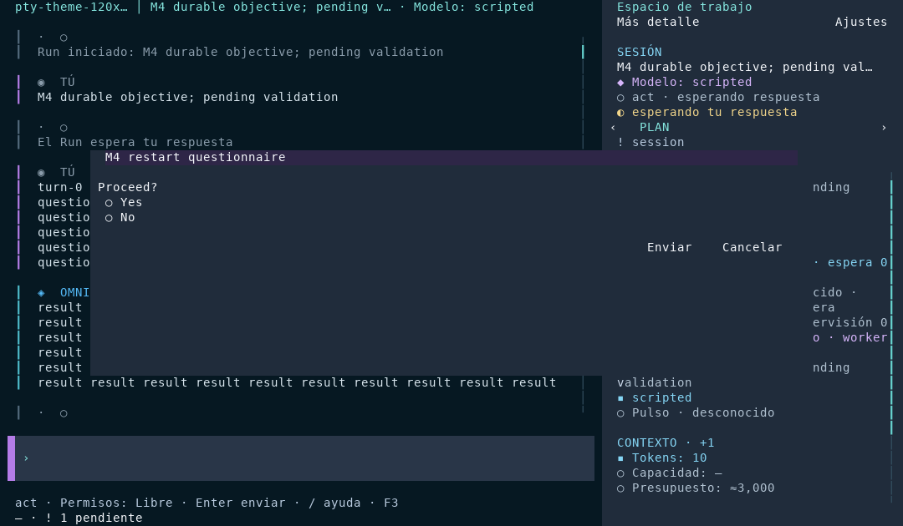
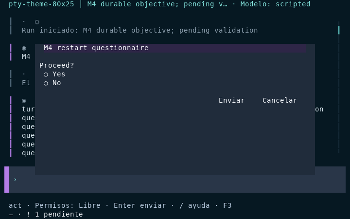
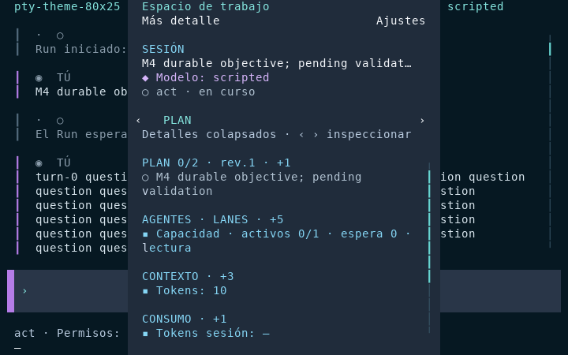

# Cierre de verificaciones Linux — 2026-10-14

Cierre Linux de M1, M4/TUI v0, M5.5, M6 y M7 acreditado por la evidencia de esta acta. La integración final con M9-B se acepta únicamente con los gates del PR aprobados; el resultado vigente se consulta en [los checks del PR](https://github.com/juancgomezm-s/OmniCore/pull/1/checks). Los intentos fallidos no se presentan como aprobados.

## Alcance y entorno

Se sustituye el diferido causado por no disponer de una distro WSL. Base `445339e`;
correcciones `4777fbd` y `cbeb4d5`; integración del nuevo main `db8e844` en `4f590c9`. Las correcciones posteriores conservan el contrato de ownership de ADR-0049. Debian 13.5/trixie en WSL2, filesystem Linux nativo,
usuario sin privilegios `omnicode-ci` (UID 2000), Git 2.47.3, SDK .NET 10.0.401 y
runtime 10.0.12. Windows se conserva como plataforma de regresión. No se modifica la
configuración, los journals ni las credenciales reales del usuario.

El checkout Linux es `/home/omnicode-ci/OmniCore-linux-20261014` y la evidencia
persistente `/home/omnicode-ci/omnicore-linux-evidence`. No se usa `/tmp` para conservar
pruebas después de apagar WSL. El árbol Linux se contrastó completo con `cbeb4d5`
mediante `git diff FETCH_HEAD --quiet`, no solo con el nombre de la rama.

## Fallos encontrados y correcciones

| Causa | Evidencia | Corrección |
| --- | --- | --- |
| Opción Windows aplicada a todos los procesos | `SystemProcessRuntime.Launch` lanzaba `PlatformNotSupportedException` en `CreateNewProcessGroup`. La primera suite Debian: 4534 casos, 4430 PASS, 88 FAIL, 16 SKIP; Git/worktrees y varios gates fallaban en cascada. | Aplicar la opción solo en Windows. Conservar cancelación, espera, captura de salida y terminación del árbol en Linux. |
| Apphost Linux sin extensión no copiado/localizado | Fixtures buscaban `OmniCore.SandboxTestProcess.exe` y el target solo copiaba `OmniCore.SandboxTestProcess.*`. | Copiar también el apphost sin extensión; resolver el nombre por plataforma. Reemplazar los comandos `cmd.exe` de las pruebas de timeout/salida por sus equivalentes Linux, conservando las assertions. |
| Cancelación stdio dependía de PowerShell | La prueba de negociación/cancelación omitía Linux. | Modo `stdio-stall` del ejecutable nativo controlado. Ejecutar el timeout y comprobar que el PID real termina también en Linux; retirar esa omisión. |
| Identidad de workspace alteraba nombres POSIX | La sustitución incondicional de `\\` por `/` confundía un nombre literal con directorios anidados. | Normalizar el separador alternativo solo en Windows. Probar las equivalencias válidas por plataforma y la distinción de identidades Linux. |
| Fixture de retención dependía del segundo de creación | Dos snapshots de igual árbol/padre/mensaje pueden producir el mismo commit. El backend conserva correctamente una referencia todavía usada por un worktree activo; el test esperaba que se podara. | Dar árboles distintos al caso de poda y afirmar commits distintos. Añadir un caso determinista con base HEAD que exige preservar el commit compartido. No relajar la protección productiva ni añadir esperas/retries. |
| Escenarios YAML no compatibles con AOT | Publicación local y [primer CI](https://github.com/juancgomezm-s/OmniCore/actions/runs/38659409570): `ScenarioLoader.cs:49`, IL3050 por `DeserializerBuilder`, después IL3053/IL2104. Host suprimía IL3050 en el build ordinario. | Leer el árbol YAML sin reflexión, reutilizando la API de representación que ya usa ConfigLoader. Conservar mapas/listas/escalares/aliases con identidad, acotar profundidad y probar null/strings/aliases/documentos múltiples. Retirar la supresión de Host. |

El intento inicial con contexto estático de contenedores no tipados hizo fallar el
generador con CS8785/IndexOutOfRangeException. No se mantuvo, ni se cambiaron versiones:
la solución final usa `YamlStream`, sin generación dinámica ni warnings suprimidos.
La primera invocación del runner con una extensión TRX no instalada ejecutó cero tests
(exit 5); no se contabiliza como una validación. Los fallos intermedios se conservan.

## Evidencia ya obtenida

- Restore/build Linux y Windows: cero advertencias y errores en las pasadas correctas;
  Protocol, Client y Sandbox incluyen net8/net10. Arquitectura: 62 casos, incluida en
  la integral; no sumar otra vez.
- Windows focal de procesos, Git, AppContainer, identidad, M2 y stdio: 146/146 PASS,
  cero omisiones. Focal final de YAML/retención: 27/27 PASS en Windows y en Debian.
- Pasada Debian anterior a la corrección de la fixture de retención: 4535 casos,
  4519 PASS, 1 FAIL, 15 SKIP. El fallo remanente es el descrito arriba, no se registra
  esa pasada como verde.
- [CI Ubuntu sobre 4777fbd](https://github.com/juancgomezm-s/OmniCore/actions/runs/38659409570/job/116176844287):
  4536 casos, 4521 PASS, 0 FAIL, 15 SKIP; 6m37s. No acredita aún el arreglo YAML posterior.
- CLI Debug y primera distribución autónoma Linux: los cinco YAML y el crash explícito
  pasan. Conteos de eventos: multi-item 57, TaskGraph 59, permisos 57, aprobación 51,
  crash YAML 30 y crash explícito 30. SQLite confirma que resume conserva el prefijo,
  solo existe una ToolCall iniciada/reconciliada y el segundo resume no escribe eventos.
  `verify-journal` pasa en los seis workspaces aislados.
- El YAML de crash devuelve 0 por aceptación del escenario, aunque deja el efecto
  interrumpido. `--crash` devuelve 1/Interrupted. La guía M1 se corrige para no confundir
  estos contratos ya fijados por las pruebas existentes.

## Cierre de la pasada completa y distribución

La suite completa de los binarios de `cbeb4d5`, antes del bloque M9-B, pasó en Debian:
**4541 casos, 4526 PASS, 0 FAIL, 15 SKIP, 11m26s**, incluida arquitectura (62).
Las omisiones son siete casos de inferencia/diagnóstico con opt-in y ocho de Windows
(AppContainer/MCP Strong/contrato de batch). La cancelación stdio ya no se omite en Linux.
La nueva prueba de barra invertida literal se marca explícitamente como no aplicable en
Windows; no se omite en Linux. No se deshabilitaron pruebas existentes.

Ambas distribuciones Linux x64 pasaron sus seis escenarios, verificación SQLite/recovery
y dos PTY reales. Native AOT publicó sin IL2xxx/IL3xxx; `omni` ocupa 35.074.672 bytes,
SHA-256 `b0e4a3592770550392173171893182214e005f3ee49c4ceadf66fa87bf4f2b70`.
Incluye `libonigwrap.so` y `libe_sqlite3.so`. El job `linux-package` también pasó para
`cbeb4d5` y después de integrar M9-B en `4f590c9`; ver [ejecución de integración](https://github.com/juancgomezm-s/OmniCore/actions/runs/38661297379).
El smoke definitivo elimina DOTNET_ROOT del entorno del ejecutable para no apoyarse en
la instalación del SDK. Las rutas de evidencia distinguen cada binario y pasada.

## Integración del main que avanzó durante la validación

Main incorporó `e703584`/`db8e844` (M9-B) durante este trabajo. Se integró sin conflictos,
conservando las correcciones Linux y el nuevo protocolo. No se sobrescribió su trabajo.
Build integrado Debian: cero errores/advertencias. Stdio + JournalEnvelope: **38/38 PASS**,
sin omisiones; incluyen procesos distintos, liberación tras muerte del dueño, ACK perdido,
lookup sin resend, resultado ambiguo, fallback legacy y replay acotado/paginado.

La primera integral Ubuntu de esa combinación ejecutó 4549 casos: 4531 PASS, 3 FAIL y
15 SKIP. [Logs](https://github.com/juancgomezm-s/OmniCore/actions/runs/38661297379/job/116183034165).
Los tres fallos compartían ciclo de vida incompatible con el nuevo lease: el test de
reapertura mantenía vivo el runtime anterior, y los dos de purga mantenían el writer que
había sembrado la sesión. Se cierra el runtime previo al reabrir y se libera el writer
antes de invocar la purga independiente. Las assertions de historial/auditoría/borrado
se mantienen. Se añade además un caso de sesión ocupada: error 1 explícito, sin eventos
borrados ni auditoría falsa, y el contendiente fallido no revoca el lock del dueño.
El comando real informa el conflicto mediante texto localizado en es/en/fr/it.

La referencia Infrastructure añadida al ejecutable de fixtures por M9-B hacía fallar el
paquete mínimo de extensiones: FileNotFoundException de OmniCore.Infrastructure al entrar
en la máquina async del programa. Se reprodujo fuera del sandbox (exit -532462766).
El modo session-lock pasa a una función no inline separada; los demás modos conservan su
paquete mínimo, y el probe sigue usando el store de producción. No se amplían grants ni
se copian dependencias adicionales al sandbox. Regresión Windows tras corregirlo:
**12/12 PASS**, sin omisiones, incluidos AppContainer, MCP Strong y lock entre procesos.
La focal de mantenimiento/reapertura/identidad dio **36 PASS / 0 FAIL / 1 SKIP Unix**.
Tras las correcciones, el bloque conjunto de M9/journal, mantenimiento, reapertura e
identidad pasó en Debian: **75/75 PASS**, cero omisiones; build limpio. Un intento
anterior no llegó a iniciar las pruebas por timeout de creación de VM de WSL
(0x800705b4); el arranque posterior funcionó y esa ejecución sin tests no cuenta como
validación. La integral final y los tres jobs siguen siendo gates antes de integrar.

El primer job Windows agotó el límite global de 25 minutos, sin completar la suite; la
anotación exacta fue “The job has exceeded the maximum execution time of 25m0s”. Ese
intento no acredita Windows. Se asignan 50 minutos a Windows y se activa salida Detailed
para conservar progreso por prueba; Ubuntu mantiene 25. No se cambian los timeouts de
las pruebas, incluido M4, ni se añaden retries ni resultados simulados.

La siguiente [integral Ubuntu sobre 9fe934b](https://github.com/juancgomezm-s/OmniCore/actions/runs/38663511466/job/116190270718)
ejecutó 4550 casos: 4533 PASS, 2 FAIL y 15 SKIP. Otra fixture de reapertura conservaba
el runtime previo; ahora lo libera antes de volver a conectar, manteniendo el lease
de producción. El servidor HTTP de pruebas contaba una conexión TCP vacía de doctor
como petición al modelo: el cierre sin línea HTTP se descarta antes de incrementar
el contador. Se conserva la assertion de que una configuración inválida impide toda
petición al modelo. Las fixtures restauran y cierran sus runtimes al terminar.

La revisión del lector YAML detectó que el límite posterior a YamlStream.Load llegaba
demasiado tarde: una entrada de 64000 mapas anidados agotaba 15 segundos. Un wrapper
del parser rechaza la profundidad superior a 128 antes de construir o resolver el
grafo. Una prueba determinista exige ese rechazo antes de resolver un alias inválido;
no usa umbrales de tiempo. El CLI Debug real rechaza la misma entrada de 64000 mapas
en 0,943 s, exit 1 y mensaje «Maximum YAML nesting exceeded.». La suite completa de
CLI y YAML posterior pasa en Debian y Windows: **74/74 PASS** en cada plataforma,
sin omisiones. Estos resultados focales no sustituyen los tres gates finales del CI.

Los logs del intento Windows de esa revisión, cancelado al publicar la siguiente,
también registraron tres fallos adicionales. La captura de scrollbar esperaba el texto «Enter enviar», pero al enfocar la conversación
el pie puede mostrar la ayuda de enlaces. El fotograma diagnóstico mostró esa ayuda
y el rail correcto; la espera usa ahora «Historia», contenido de la conversación.
Se mantienen las assertions de colores, glifos y navegación, sin tocar la TUI.
Forzar un repintado completo no resolvió la causa y se retiró esa tentativa. El caso de ACK perdido intentaba abrir SQLite en solo lectura justo
después de matar el writer; Windows devolvió SQLite Error 10 al leer el esquema.
Ahora toma el conteo antes de matar el proceso, deja la recuperación WAL al siguiente
writer y exige que la reconexión conserve ese conteo, los recibos y la deduplicación.
No se ignoran errores de SQLite ni se degrada la durabilidad. Referencia del formato:
[recuperación WAL](https://sqlite.org/walformat.html).
La suite completa de TuiWiringTests, StdioTransportTests y M3CoderGatesTests después
de esas correcciones pasó en Windows: **224/224 PASS**, cero omisiones, exit 0.
El tercer síntoma fue Git intentando abrir /dev/null. El launcher AppContainer
configuraba STARTF_USESTDHANDLES pero entregaba stdin=0 si no había payload. La nueva
prueba nativa falló con exit 28/INVALID_STDIN sin payload y pasó con texto. Se crea
siempre un pipe válido, se limita su herencia al hijo y se cierra su writer para dar
EOF. No se hereda la consola ni se amplían ACL/capabilities. La corrección sigue
el [contrato de STARTUPINFO](https://learn.microsoft.com/en-us/windows/win32/api/processthreadsapi/ns-processthreadsapi-startupinfoa).
La pasada intermedia dio 40 PASS / 1 FAIL: stdin ya pasó, pero reapareció la espera
del pie de la captura. Ese resultado motivó el diagnóstico exacto descrito arriba;
no se acredita como verde ni se añaden retries.

Con el marcador correcto y el pipe de stdin válido, la focal Windows final pasó:
**41/41 PASS, cero omisiones, exit 0, 1m14s**. Incluye los dos casos de stdin
(payload y EOF sin payload), AppContainer, MCP Strong, transporte/reconexión, gates
M3 y scrollbar en color/NO_COLOR. La integral del nuevo commit sigue siendo gate.

## Recuperación y TUI M4

El probe de producción completa 200 turnos con compactación en SQLite/CAS. `seed`
(PID 18306) valida 1664 eventos y el segundo proceso restaura objetivo, WorkingState,
checkpoint y pregunta pendiente sin alterar los payloads de baseline. Verificador:
1 sesión, 1664 eventos, 1849 referencias a artifacts, OK. Seed: 131.240 s, dentro del
límite existente de 3 minutos; esta pasada compartía máquina con compilaciones y no
es una medición comparativa de rendimiento.

Dos copias independientes del journal se abren con `TuiApp.Run` de producción en PTY
Linux reales 120×35 y 80×25. La pregunta `M4 restart questionnaire / Proceed?` reaparece.
Escape cancela por acción de teclado; después hay exactamente `interaction.resolved`
y `user_input.received` nuevos. F2 abre el panel estrecho. Salida explícita: exit 0 en
ambos procesos. Las rasterizaciones siguientes representan el ANSI capturado con sus atributos RGB; no son screenshots del escritorio. No se afirma prueba de
resize dentro de un mismo proceso ni cualificación de un LLM por este probe scripted.





## Reproducción y CI

```sh
dotnet restore OmniCore.slnx
dotnet build OmniCore.slnx --no-restore
dotnet test --solution OmniCore.slnx --no-build --no-restore --max-parallel-test-modules 1 --parallel none < /dev/null
bash scripts/validate-linux-package.sh /ruta/externa/nueva/linux-package
```

El último script necesita clang/build-essential/zlib1g-dev y Python 3; publica Linux x64
self-contained y Native AOT. Cada ejecutable real procesa YAML, carga SQLite, recupera
el journal y arranca/sale de TUI en las dos dimensiones de PTY. Comprueba la presencia
de `libonigwrap.so`; no acredita funcionalidad por la sola existencia del binario.
Cualquier fallo mantiene su código y muestra el log técnico; no hay `continue-on-error`.

`.github/workflows/ci.yml` mantiene la matriz Windows/Ubuntu y el job `linux-package`,
en PR a main y push a main, además de dispatch manual. Usa `global.json`, todas las
pruebas existentes y warnings de publicación como errores. No necesita claves de
proveedores. Conserva logs, hashes, resúmenes y ANSI de los paquetes como artefactos.

## Pendientes que no eran solo falta de WSL

- M2/M3: aceptación manual con el modelo local todavía necesaria.
- M3 y partes Strong de M8: no existe backend Linux bubblewrap/Landlock/seccomp en el
  código. Los probes reales de user namespaces, bubblewrap y Landlock sí funcionan
  como UID 2000; el bloqueo restante es implementación, no instalar WSL. Nunca se
  declara Strong por detectar herramientas ni se degrada sin WeakSandboxConsent.
- M5: la cualificación autenticada ya documentada conserva su alcance Windows;
  los tests deterministas Linux no se presentan como nuevas inferencias reales.
- M8: OR5 autenticado y el diagnóstico de consumidores diferidos de metadatos de skills
  permanecen en M8. El CI no configura ni consume la cuenta del usuario.
- OAuth: las pruebas offline no acreditan login/inferencia real; el almacén AES-GCM
  Linux sigue siendo provisional según ADR-0018/0038, sin atribuir Secret Service.
- M9/M10: M9-B ya integra lease, receipts, dedup/Unknown y replay/reconexión; 38 focales reales pasaron en Debian. M9-C integró después el consumidor TypeScript de lectura y el supervisor Electron en Windows. Siguen pendientes autoridad humana externa, aceptación Linux del consumidor OmniCoder, chat/acciones, push, media y procesos persistentes/ConPTY. M9 no se declara cerrado globalmente.
- Linux arm64 y macOS no se validaron por ejecutar Linux x64 en este equipo.
## Conservación del estilo aprobado

La comparación de la rama con main no presenta cambios en src/OmniCore.Cli/Tui ni en los estilos del Client. El primer arnés usaba -noColor y una rasterización monocroma; servía para comprobar recuperación, pero no para presentar el diseño. Tras la observación del usuario se retiró ese flag del probe visual, se conservan foreground/background RGB del ANSI y se sustituyen las tres imágenes. Las pruebas de accesibilidad NO_COLOR siguen activas y se distinguen de la evidencia visual normal.

El árbol Git de `src/OmniCore.Cli/Tui` es idéntico al de main `db8e844`:
`67cd1d6469662f5967cfb0db439a4bce65183eb2`. Este identificador permite verificar que
los archivos visuales aprobados se conservaron íntegros.

## Integral Debian después de las correcciones de CLI/YAML

Sobre `5a581f9`, build limpio y suite completa: **4551 casos, 4536 PASS, 0 FAIL,
15 SKIP, 11m37s**. El runner registró exit 0 en acceptance-next-exit.txt. La envoltura
externa terminó después con error de sintaxis al interpretar un CRLF en su última
línea exit; se corrigió el archivo del arnés externo para usar LF. No es un fallo de
las pruebas ni se usa el código de esa envoltura como prueba de éxito.
[Ubuntu CI sobre el mismo código](https://github.com/juancgomezm-s/OmniCore/actions/runs/38666001163/job/116198154334)
y linux-package también aprobaron. La revisión posterior de fixtures Windows y stdin
requiere una nueva pasada del CI antes de integrar.

Main avanzó a `f823371` durante la última publicación. Se integró también M9-C,
resolviendo únicamente solapamientos de documentación en CLAUDE.md y arquitectura: se
conservan tanto el avance del consumidor Electron/TypeScript como la evidencia Linux.
Los tres commits nuevos de main no cambian código Core ni estilos. La aceptación
Windows del consumidor M9-C no acredita su interfaz Electron en Linux.

La focal ampliada Debian posterior ejecutó 236 casos: 228 PASS, 1 FAIL y 7 SKIP
AppContainer. El fallo de catálogo tras resize leía desde el hilo del test el frame
del padre ya actualizado junto a un botón hijo todavía en layout. La assertion exacta
de que cada control cabe en el viewport se ejecuta ahora en el hilo UI; no se cambia
el layout ni se amplían tolerancias. Catálogo/scrollbar después del ajuste:
**4/4 PASS en Debian y 4/4 PASS en Windows**, sin omisiones, exit 0 en ambos.
La integral y el empaquetado del PR siguen siendo obligatorios sobre la revisión final.

La [integral de 0789ebf](https://github.com/juancgomezm-s/OmniCore/actions/runs/38668015994)
aprobó Ubuntu (4553 casos, 4536 PASS, 17 SKIP, 0 FAIL, 8m45s) y linux-package.
Windows ejecutó los 4553 casos: 4543 PASS, 2 FAIL, 8 SKIP, 27m03s. Persisten SQLite
Error 10 después de matar el Host (ahora al abrir el writer, línea 144 del test) y
el fallo Git /dev/null. El ajuste previo de readonly no resolvió el primero y el
pipe válido de stdin no resolvió el segundo, aunque corrige un defecto independiente
demostrado por el probe nativo. No se presenta esa integral Windows como verde.
El runner usa Git 2.55.0.windows.5; este equipo tenía 2.54.0.windows.1. Se descarga
la distribución oficial exacta a un directorio de diagnóstico, verificando su digest,
sin cambiar Git instalado ni versiones del proyecto. Se añade temporalmente un job
focal Windows para exponer SQLiteErrorCode/ExtendedErrorCode y el stderr completo;
la matriz y todas las pruebas integrales siguen activas.
